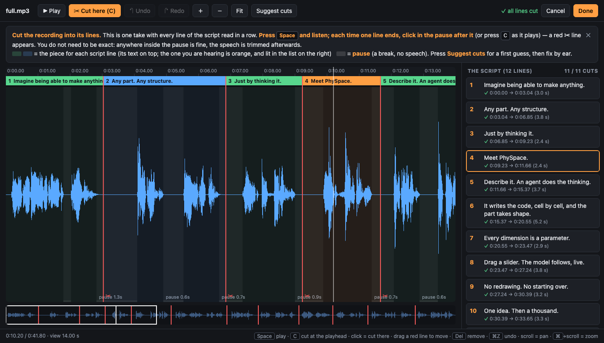
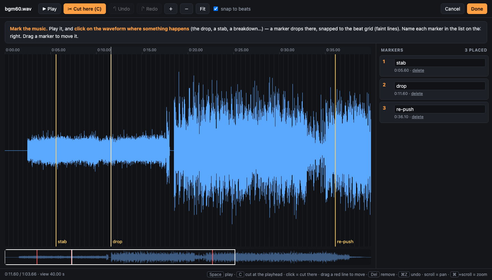
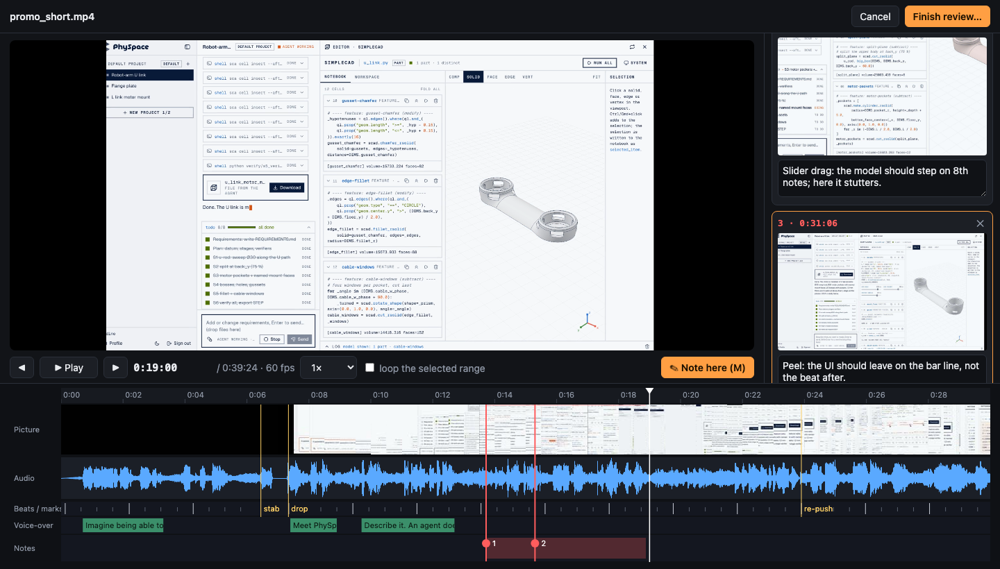

# promo-video

A Claude Code skill that makes a **beat-synced product promo film** end to end, with a human in the loop. Music → storyboard → voice-over script → cut the take → build in Remotion → review the render in the browser. Every cut lands on the music's beat; everything shown is real (your meshes, your code, your UI rebuilt from the frontend).

```bash
npx skills add NiJingzhe/promo-video-skill
```

Needs `ffmpeg`, `node` 20+ and [`uv`](https://docs.astral.sh/uv/). Then tell Claude: **"Use promo-video to make a ~40 s promo for \<product\>."** (中文说明见下方。)

---

## SOP · 标准流程

> 原则：**人只做判断，机器做体力活。** 每个阶段以一个人能直接看见、听见、点一下的东西收尾，不让你读技术细节。
> Principle: the human only judges; every stage ends in something you can see, hear or click.

| # | 阶段 Stage | 你 You | Claude | 产物 Output |
|---|---|---|---|---|
| 1 | **音乐 Music** | 在 [Epidemic Sound](https://www.epidemicsound.com) 选曲，点曲目上的小剪刀 **Create a cut**，得到指定时长、有完整收尾的版本（无版权，可商用） | 分析曲子：真实 BPM、拍点、小节线、drop / 停顿 / 渐强 | `audio/track.wav`、`beats.json` |
| 2 | **分镜 Storyboard** | 回答几个问题（产品、受众、感觉、必须出现什么），看分镜表，点头或改 | 写 `PLAN.md`：每个镜头几点几秒、画面、踩哪一拍 | `PLAN.md` |
| 3 | **旁白 Voice-over** | 去 [ElevenLabs](https://elevenlabs.io) 选声音，把 Claude 给的**整段带 `<break>` 的脚本一次生成**，把 mp3 给 Claude | 写旁白、整理成 `elevenlabs.md` | `vo/take.mp3` |
| 4 | **切分 Cut** | 在浏览器页面里**听一遍，每句结束点一下**（下图） | 按你的切点切成一句一句、统一响度、排到画面上 | `vo/vo_NN.wav`、`clips.json` |
| 5 | **制作 Build** | 看关键帧截图和草稿 | 用 Remotion + three.js：写实金属、产品 UI 复刻、推拉摇移，所有事件对齐拍点 | `out/promo.mp4` |
| 6 | **审片 Review** | 在审片页里边看边留备注，选“通过 / 需要修改”（下图） | 逐条看备注和对应画面，修好重渲，再请你审，直到通过 | `review/review.json` |

**可选**：装了 `ego-browser` / Playwright 之类的浏览器自动化工具时，Claude 会**征求你同意**后替你在 Epidemic Sound 找曲下载、在 ElevenLabs 生成旁白。需要你**自己有账号**（它们不代注册）；ElevenLabs 按字符计费、重新生成会重复计费，Claude 会先说明预估花费；**登录、验证码、付款永远由你完成**；曲子和声音由你选。

### 阶段 4 · 切旁白：点一下，切这里

右边是脚本逐句列出，中间是整段录音。有声与**停顿（break）**分开显示；当前听到的是哪一句会高亮。按空格播放，**每听到一句结束，在停顿里点一下（或按 C）**，不用精确，停顿里任何位置都行，语音会自动修边。



```bash
uv run scripts/cut_ui.py vo/take.mp3 --mode cuts --script elevenlabs.md --out vo/cuts.json
uv run scripts/vo_cut.py vo/take.mp3 --regions vo/cuts.json --out vo/
```

### 阶段 1 · 标记音乐关键点（可选）

分析器的判断拿不准，或者你想亲手定 drop / stab / re-push，就用同一个页面标音乐：节拍格画在波形上，点一下就落下一个带名字的标记，并**吸附到节拍**。



```bash
uv run scripts/cut_ui.py audio/track.wav --mode marks --beats audio/beats.json --labels stab,drop,re-push --out audio/marks.json
```

### 阶段 6 · 审片：画面上直接留备注

上方监视器，下方时间线条：**画面缩略图 + 成片音频波形**（音频已混在成片里，所以只有一条）+ 可选的**节拍 / 音乐标记 / 旁白**标注，卡点对不对一眼可见。按 **M** 在当前画面上留一条备注，**每条备注自带当时那一帧**；在红色 Notes 轨上拖一段就是范围备注。完成时选“通过”或“需要修改”。



```bash
uv run scripts/review_ui.py out/promo.mp4 --out review/review.json --overlay review/overlay.json
```

快捷键：`Space` 播放 · `←/→` 逐帧 · `Shift+←/→` 一秒 · `M` 备注 · `Del` 删除 · `⌘/Ctrl+Z` 撤销 · `⌘/Ctrl+滚轮` 缩放。

---

## What is in the box

| Path | |
|---|---|
| `SKILL.md` | the workflow Claude follows (six stages, ground rules, browser-automation etiquette) |
| `references/` | one guide per stage: music, storyboard, voice-over, build, review |
| `scripts/music_analyze.py` | true BPM (fitted, not guessed), beat/bar grid, sections, the drop |
| `scripts/music_splice.py` | shorten a track with a bar-aligned, crossfaded jump; verifies the join |
| `scripts/cut_ui.py` | browser page: cut a voice-over take by clicking between its lines / mark music on the beat grid |
| `scripts/vo_cut.py` | split the take into levelled (-15 LUFS) clips + `clips.json` |
| `scripts/review_ui.py` | browser review page: monitor + timeline strip, notes with exact frames |
| `scripts/new_project.sh` + `template/` | Remotion project: metal studio (three.js), beat clock, VO mix, virtual camera for UI flights, CAD mesh tools |

The browser pages are single-file, dependency-free Python servers on `127.0.0.1`: the agent starts one in the background, the human works in the tab, presses **Done**, the tab closes itself and the agent receives a JSON file.

## License

MIT
